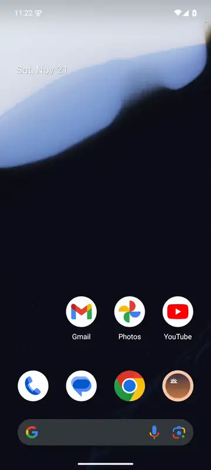
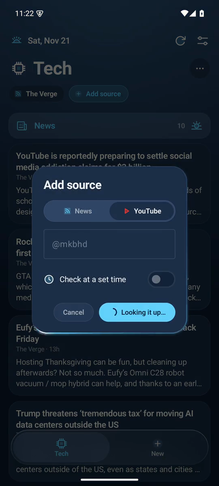
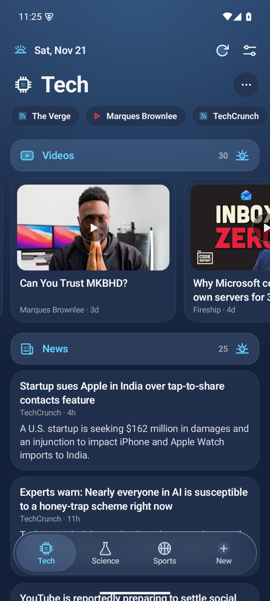
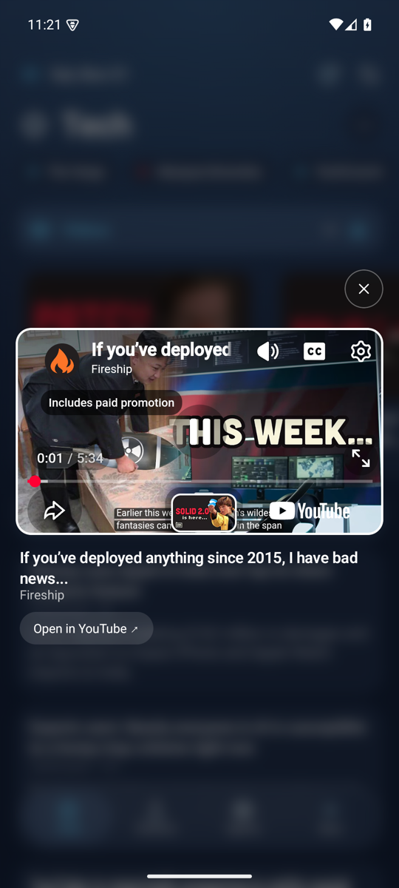
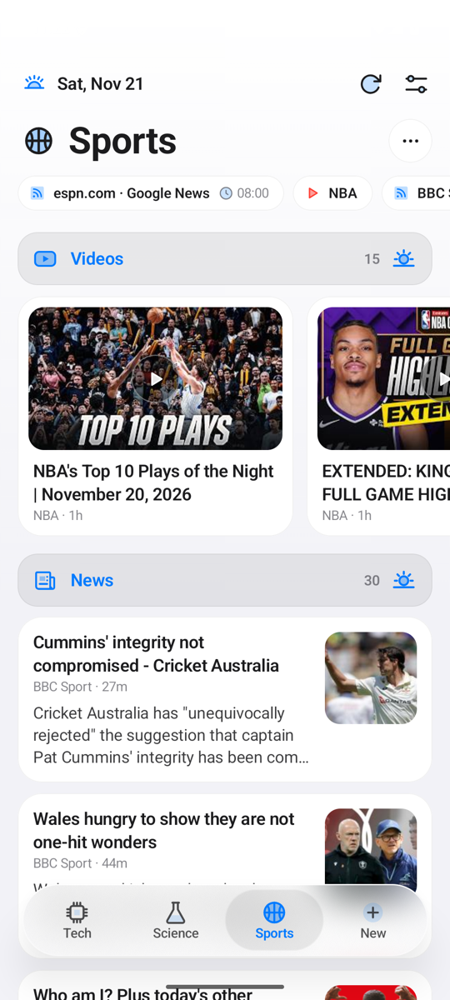
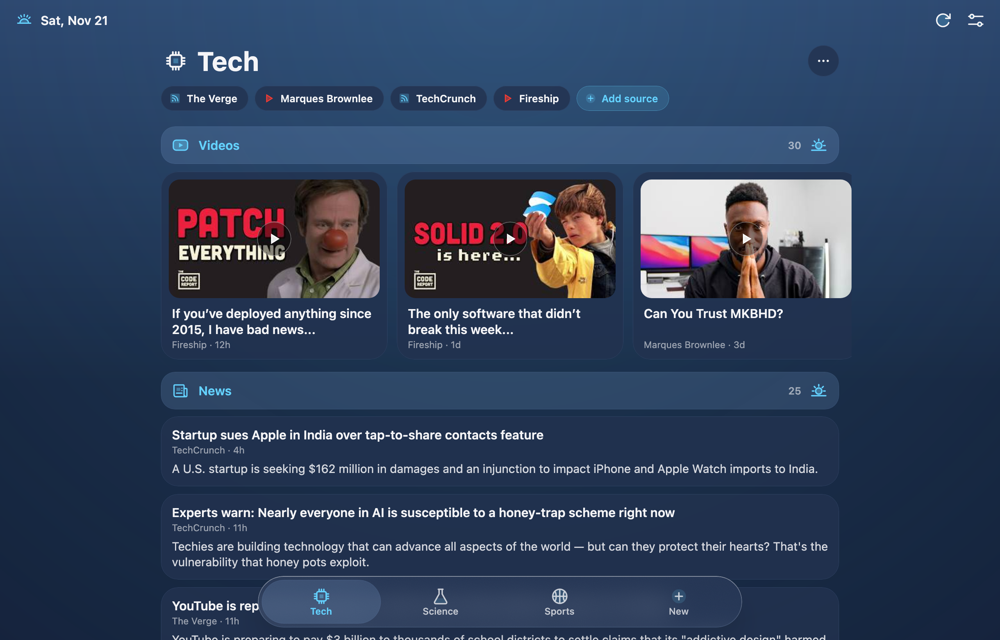

# Morning Report

Your own morning feed. Start with an empty page, create the sections you care about (Economy, Sports, anything), and fill them with the news sites and YouTube channels you follow. No account, no server, no algorithm deciding for you: the app reads the sources straight from the sites, on your device.

Runs on **Android**, **macOS**, **Windows** and **Linux** from one codebase (Kotlin + Compose Multiplatform). English and Turkish.

<p align="center">
  <a href="docs/demo.mp4"></a>
</p>

The demo above plays by itself (1 minute 32 seconds, no sound). To pause or scrub, [open the video in a player](docs/demo.mp4).

<p align="center">
  
  
  
  
  
</p>



**The look:** Liquid-Glass style navigation (a blurred glass top bar once content scrolls under it, a floating glass tab bar with a lens that slides under the open section and hides while you read down), translucent cards on a parliament-blue backdrop in dark mode or iOS-style white cards in light mode, two-tone line icons, collapsible blocks with a sunrise mark, a light that runs round the card while a source is being looked up, and a video player that grows out of the middle of the screen.

[Türkçe açıklama aşağıda ↓](#türkçe)

## Download

Get the latest files from **[Releases](../../releases/latest)**:

| Platform | File | First launch |
|---|---|---|
| Android 8+ | `MorningReport-…-android.apk` | Open the file on the phone and allow installing from your browser or file manager when Android asks. |
| macOS (Apple silicon) | `MorningReport-…-macos.dmg` | Drag the app to Applications. The app is not notarized yet: the first time, **right-click → Open → Open**. |
| Windows 10/11 | `MorningReport-…-windows.msi` | Run the installer. If SmartScreen warns, choose **More info → Run anyway**. |
| Linux (Debian/Ubuntu) | `MorningReport-…-linux.deb` | `sudo apt install ./MorningReport-…-linux.deb` |

## How it works

1. **Create a section.** Tap *Create a section* (or *+ New section*) and name it: Economy, Sports, Science…
2. **Add sources to it.** Tap *+ Add source*, choose **News** or **YouTube**, and paste what you have:
   - News: a site (`theverge.com`, `bbc.com/sport`) or a feed link. The app finds the site's RSS/Atom feed by itself. A site that publishes no feed, or blocks apps, is read through Google News instead, and its name says so (`aa.com.tr · Google News`).
   - YouTube: `@handle`, a channel link, or any video link from that channel.
3. **Optionally give a source a time.** Switch on *Check at a set time* and write `08:00`: automatic checks read that source once a day, from that time on. Sources without a time are read on every automatic check.
4. **Read.** Swipe between sections or tap them in the tab bar. Each section shows its videos as a row of cards and its news as a list, newest first; tap *Videos* or *News* to fold a block. On Android a video plays right in the app in a pop-up player (the page behind blurs; fullscreen turns the phone sideways and back upright when you leave it); on desktop videos and articles open in the browser. *Refresh* (or pull down) reads every source right away.

Automatic checks: on Android a background check runs about every 15 minutes (the shortest Android allows) and notifies you when there is something new; on desktop the app checks every minute while it is open. Items older than a week are dropped.

Tap a source chip to change its time, open its site or remove it. The `⋯` menu next to a section's title renames, moves or deletes it.

## AI filtering (optional)

Off by default. When on, a language model that **you** run scores each new item from 0 to 10 against interests you describe in your own words. Items under your threshold are not deleted, they are folded under *Hidden by AI*. Any server that speaks the OpenAI chat API works.

### On a computer (Ollama, free, stays on your machine)

1. Install [Ollama](https://ollama.com/download) (macOS, Windows, Linux).
2. Download a small model once (about 3.4 GB):
   ```
   ollama pull gemma3:4b
   ```
   A bigger model such as `gemma3:12b` scores better if your computer has the memory for it.
3. In Morning Report open **Settings → AI filtering**, switch it on and fill in:
   - **Server address:** `http://localhost:11434/v1`
   - **Model:** `gemma3:4b`
   - **Your interests:** for example *"Central bank decisions and inflation, the NBA (Lakers), new AI models. Not celebrity news."*
   - **Hide below:** 5 is a good start.
4. Press **Test and re-score**. If it says the model answered, you are done: from now on new items are scored as they arrive.

### On Android

Phones are too small to run a useful model comfortably, so let the phone use the model on your computer:

1. On the computer, make Ollama listen on the network:
   - macOS: `launchctl setenv OLLAMA_HOST "0.0.0.0"`, then quit and reopen Ollama.
   - Windows: add a user environment variable `OLLAMA_HOST` = `0.0.0.0`, then restart Ollama.
   - Linux (systemd): `sudo systemctl edit ollama` → add `Environment="OLLAMA_HOST=0.0.0.0"` under `[Service]`, then `sudo systemctl restart ollama`.
2. Find the computer's local IP address (e.g. `192.168.1.20`) and allow port 11434 if a firewall asks.
3. In the app on the phone use **Server address** `http://192.168.1.20:11434/v1` and the same model name. Phone and computer must be on the same Wi-Fi.

### With a hosted service

Use the service's OpenAI-compatible address, a model name and an **API key** (e.g. OpenAI: `https://api.openai.com/v1` and one of its small models). Note that the titles and short summaries of new items are then sent to that service.

## Privacy

Everything is stored on the device in one file (`data.json`; on desktop under `~/Library/Application Support/Morning Report`, `%APPDATA%\Morning Report` or `~/.local/share/morning-report`). The app talks only to the sites you add, to YouTube's public feeds, to Google News for sites without a feed, and to the AI server you configure, if any.

## Build from source

JDK 17+ and, for Android, the Android SDK.

```
./gradlew :composeApp:run                 # desktop app
./gradlew :composeApp:assembleDebug       # Android APK → composeApp/build/outputs/apk/debug/
./gradlew :composeApp:packageDmg          # or packageMsi / packageDeb on that OS
./gradlew :composeApp:desktopTest         # tests; LIVE=1 also checks real sites
```

Pushing a tag such as `v1.0.1` builds all four packages on GitHub Actions and attaches them to the release (see `.github/workflows/release.yml`). The Android build is signed when the `ANDROID_KEYSTORE_B64`, `ANDROID_KEYSTORE_PASSWORD` and `ANDROID_KEY_ALIAS` secrets are set.

The demo recording is the real app driven by `Demo.kt`: `adb shell am start -n app.morningreport/.MainActivity --ez demo true`, or `--demo` on desktop.

## License

MIT, see [LICENSE](LICENSE).

---

## Türkçe

**Sabah Raporu**, sabah okuduklarını tek yerde toplayan bir uygulama. Boş başlar: Ekonomi, Spor ya da istediğin başka başlıkları sen açarsın, her başlığa takip ettiğin haber sitelerini ve YouTube kanallarını eklersin. Hesap yok, sunucu yok; uygulama kaynakları doğrudan sitelerden, senin cihazında okur. Telefon dili Türkçeyse arayüz Türkçe açılır.

**İndir:** [Releases](../../releases/latest) sayfasından cihazına uygun dosyayı al (Android `.apk`, Mac `.dmg`, Windows `.msi`, Linux `.deb`). Mac'te ilk açılışta **sağ tık → Aç → Aç**, Windows'ta uyarı çıkarsa **Ek bilgi → Yine de çalıştır**.

**Kullanım:**
1. **Başlık oluştur:** Ekonomi, Spor, Bilim…
2. **Kaynak ekle:** *Haber* ya da *YouTube* seç. Haber için site adresini (`bbc.com/turkce`) ya da RSS linkini yaz; uygulama sitenin akışını kendisi bulur. RSS'i olmayan siteler Google News üzerinden okunur. YouTube için `@kanal`, kanal linki ya da kanaldan herhangi bir video linki yeter.
3. **İstersen saat ver:** *Belirli saatte kontrol et*'i açıp `08:00` yazarsan o kaynak günde bir kez, o saatten sonra okunur. Saat vermezsen her otomatik kontrolde okunur. *Yenile* her zaman hepsini okur.

**AI ile ayıklama (isteğe bağlı):** Kendi çalıştırdığın bir dil modeli her yeni öğeyi ilgi alanlarına göre 0–10 arası puanlar; eşiğin altındakiler silinmez, *AI'ın gizledikleri* altında katlanır. Bilgisayarda en kolayı:
1. [Ollama](https://ollama.com/download)'yı kur.
2. Terminalde `ollama pull gemma3:4b` (bir kerelik, ~3,4 GB).
3. Uygulamada **Ayarlar → AI ile ayıkla**'yı aç: sunucu `http://localhost:11434/v1`, model `gemma3:4b`, ilgi alanlarını kendi cümlelerinle yaz (örn. *"Merkez bankası kararları, NBA, yeni yapay zekâ modelleri. Magazin değil."*), sonra **Dene ve yeniden puanla**.

Telefonda model bilgisayarda çalışır: bilgisayarda Ollama'yı ağa aç (yukarıdaki *On Android* adımları), telefonda sunucu adresine bilgisayarın yerel IP'sini yaz (`http://192.168.1.20:11434/v1`). İkisi aynı Wi-Fi'da olmalı.
